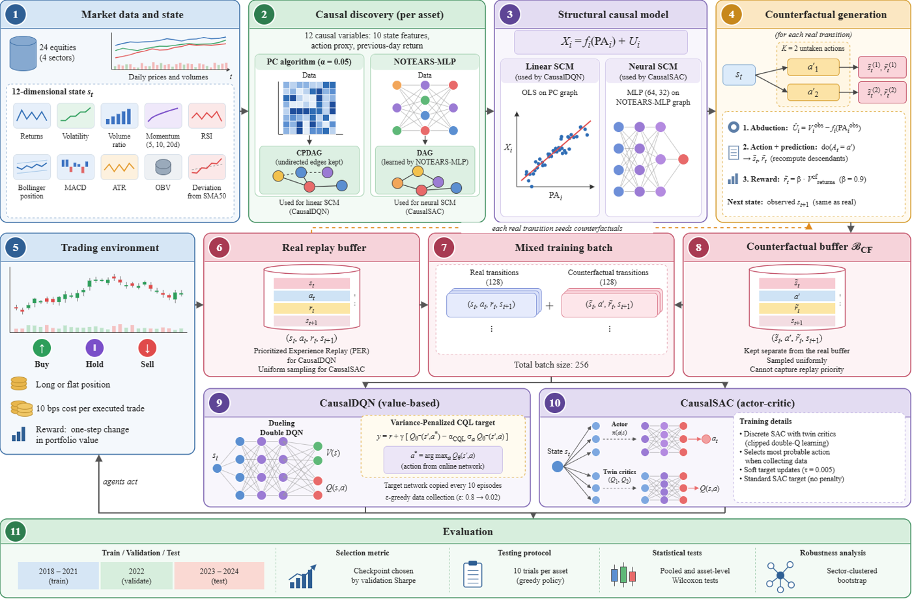
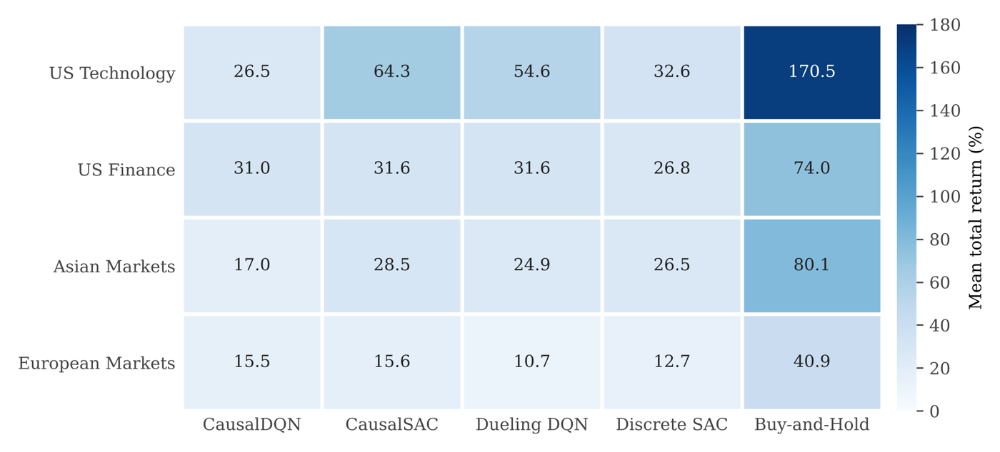
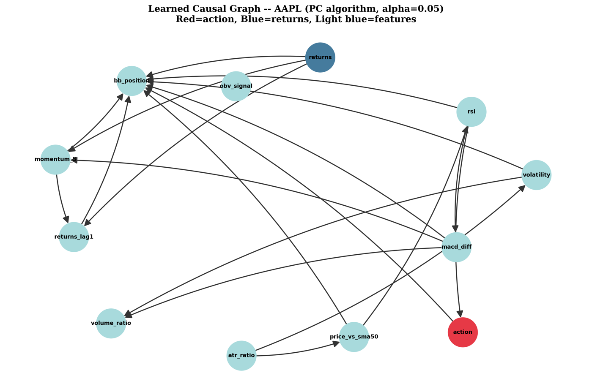

# CER-SCM: Counterfactual Experience Replay via Structural Causal Models

Official code for

> **CER-SCM: Counterfactual Experience Replay via Structural Causal Models for Off-Policy Financial Reinforcement Learning**
> Amruthamsha P. Raju, R. Viswajit, Sudhakar K, Archana Mathur, Lakshmana
> Department of AI and Data Science, Nitte Meenakshi Institute of Technology, Bengaluru
> *Under review at IEEE Transactions on Artificial Intelligence.*

A trading agent observes the outcome of the action it took, never the outcome of the alternatives, and a market cannot be reset to try again. Experience replay reuses what was observed but cannot recover what was not. **CER-SCM learns a structural causal model (SCM) for each asset and uses Pearl's abduction-action-prediction procedure to construct, for every real transition, the transitions for both actions the agent did not take.** Off-policy agents then train on an equal mix of real and counterfactual experience.



## Highlights

Out of sample on 2023-2024, net of 10 bps transaction costs, 24 equities across four global sectors, 10 trials per asset:

- **Counterfactual replay improved Discrete SAC in return and risk-adjusted return.** CausalSAC raised mean total return from **24.6% to 35.0%** (a 42.1% relative gain; pooled Wilcoxon, Bonferroni-corrected **p = 0.044**) and mean Sharpe ratio from **0.52 to 0.73** (pooled p = 0.001, asset-level **p = 0.003**). It had the highest Sharpe and Calmar ratios of any RL method and the highest mean return of the RL methods **in every sector**.
- **The gain is robust and replicates.** A sector-clustered bootstrap gives a return gap of +10.38 points, 95% interval [+2.46, +24.52], excluding zero. On an independent 30-asset universe that adds six commodity instruments, CausalSAC beat Discrete SAC by 13.6 points on **22 of 30 assets** (asset-level p = 0.001).
- **A recent-window SCM matters.** Fitting CausalDQN's SCM on the most recent half of the training window raised its return from 22.5% to 33.3% and its Sharpe from 0.446 to 0.625, improving **21 of 24 assets** (asset-level p < 0.001) and lifting it above its own baseline.
- **The paper explains when counterfactual replay helps.** It helped SAC with either SCM type, but not an epsilon-greedy DQN with the linear SCM. The DQN agent already observes its alternatives while exploring, whereas the greedy SAC agent never does. Counterfactual experience is most valuable to an agent whose own data do not cover its alternatives.

## Method

For each asset, CER-SCM learns a causal graph over 12 causal variables (ten state features, an action proxy and the previous day's return) with the PC algorithm and with NOTEARS-MLP, and fits a structural equation for every variable with parents:

$$X_i = f_i(\mathrm{PA}_i) + U_i$$

using ordinary least squares on the PC graph (linear SCM) or a 64-32 MLP on the NOTEARS-MLP graph (neural SCM). For every observed transition $(s_t, a_t, r_t, s_{t+1})$ and each untaken action $a'$:

1. **Abduction.** Recover the noise that produced the observed day: $\hat U_i = V_i^{\mathrm{obs}} - f_i(\mathrm{PA}_i^{\mathrm{obs}})$.
2. **Action.** Intervene on the decision, $\mathrm{do}(\mathrm{action} = \phi(a'))$, with Sell, Hold and Buy encoded as -1, 0 and 1.
3. **Prediction.** Recompute the descendants of the action node in topological order with the noise held fixed, $V_i^{\mathrm{cf}} = f_i(\mathrm{PA}_i^{\mathrm{cf}}) + \hat U_i$. Everything else keeps its observed value.

The counterfactual reward is the SCM's counterfactual return scaled by a trust factor, $\tilde r_t = \beta \, V^{\mathrm{cf}}_{\mathrm{returns}}$ with $\beta = 0.9$. Counterfactual transitions go to a **separate, uniformly sampled buffer**, so that model error cannot capture the priority that prioritized replay assigns to real experience, and each batch holds 128 real and 128 counterfactual transitions.

Because synthetic rewards invite overestimation, CausalDQN uses a **Variance-Penalized CQL** target that needs only quantities the Bellman update already computes:

$$\hat Q_{\mathrm{tgt}} = r + \gamma \left[ Q_{\theta^-}(s', a^*) - \alpha_{\mathrm{CQL}} \, \sigma_{a \in \mathcal{A}} Q_{\theta^-}(s', a) \right], \qquad a^* = \arg\max_a Q_\theta(s', a)$$

CER-SCM is implemented as a mixin around the replay and update logic, so it attaches to an off-policy backbone without changing the backbone itself.

## Results

**Main run: 24 assets, test period 2023-2024** (mean over 24 assets x 10 trials; 95% CI is a t-interval over asset means)

| Method | Return % (95% CI) | Sharpe | Calmar | Max DD % | p / d_z vs. Discrete SAC |
|---|---|---|---|---|---|
| **CausalSAC (ours)** | **35.01** [19.22, 50.81] | **0.731** | **1.284** | -16.89 | **0.044\*** / +0.18 |
| CausalDQN (ours) | 22.48 [11.61, 33.35] | 0.446 | 0.728 | -14.93 | 1.000 / -0.04 |
| Dueling DQN | 30.46 [15.46, 45.45] | 0.564 | 1.022 | -14.76 | 1.000 / +0.10 |
| Discrete SAC | 24.64 [16.14, 33.13] | 0.524 | 1.064 | -14.61 | reference |
| Random CF (noise instead of SCM) | 17.36 [7.45, 27.28] | 0.370 | 0.587 | -8.55 | 0.833 / -0.15 |

**Replication: independent 30-asset universe** (24 equities plus GLD, SLV, USO, DBA, PDBC, IAU)

| Method | Return % | Sharpe | vs. own backbone |
|---|---|---|---|
| **CausalSAC** | **33.50** | **0.642** | **p = 0.001; 22 of 30 assets** |
| Discrete SAC | 19.95 | 0.418 | |
| CausalDQN | 24.48 | 0.474 | p = 0.56; 13 of 30 assets |
| Dueling DQN | 26.86 | 0.537 | |

**Backbone x SCM factorial** (mean return % / Sharpe). Counterfactual replay helped SAC with either SCM; DQN improved only with the more expressive neural SCM.

| SCM | DQN backbone | SAC backbone |
|---|---|---|
| Linear (PC) | 22.48 / 0.446 | 33.62 / 0.724 |
| Neural (NOTEARS-MLP) | 32.89 / 0.589 | 35.01 / 0.731 |



**Scope.** The claim is deliberately narrow: counterfactual replay improves an off-policy agent relative to the same agent without it. Buy-and-hold returned 91.4% in the 2023-2024 equity rally and beat every strategy that spent time in cash, RL or rule-based. The paper does not claim the RL agents beat passive investment in that window.

## What the counterfactuals contain

An intervention can change only the descendants of the action node, so the learned graph decides what a counterfactual can contain. In the PC graph for AAPL below, the action node has a parent but no descendants, so its counterfactual state equals the observed state and the counterfactual reward is $\beta$ times the observed return. This explains why per-asset SCM fit did not predict the gain (all p > 0.45): what reaches the agent depends less on how accurate the equations are than on whether the action can reach the return at all. Random CF also relabels transitions but with unstructured noise, and it performed worse than the SCM-based agent in both runs.



`src/causal_structure.py` exposes `diagnose_action_descendants()` to measure this for any learned graph. `examples/synthetic_counterfactual_demo.py` makes the point concrete on simulated markets with a known causal model. When the decision really moves the market, the learned SCM recovers the true counterfactual returns (mean absolute error 0.012). When the decision is a proxy the market ignores, the true graph gives pure relabelling, while the PC graph, whose unoriented momentum-action edge is kept in both directions, gives the action spurious descendants and produces counterfactuals that look informative but are wrong (error 0.34). Neither failure shows up in SCM fit statistics, which is the open question this work leads to: when does counterfactual experience carry real causal information?

## Repository contents

```
cer-scm/
├── src/
│   ├── causal_structure.py   # 12 causal variables; PC / NOTEARS-MLP discovery; action-descendant diagnostic
│   ├── scm.py                # StructuralCausalModel: linear or neural equations, abduction-action-prediction
│   ├── cer.py                # CounterfactualGenerator (Eqs. 5-7), separate CF buffer, 50/50 mixed batch,
│   │                         # Variance-Penalized CQL target (Eq. 8)
│   └── metrics.py            # total return, Sharpe, Calmar, max drawdown, win rate
├── notebooks/
│   ├── CER_SCM_main_24_assets.ipynb          # full pipeline with recorded outputs of the main run
│   └── CER_SCM_replication_30_assets.ipynb   # the independent 30-asset replication run
├── examples/
│   └── synthetic_counterfactual_demo.py      # CPU, seconds: counterfactuals against a known ground truth
├── tests/
│   └── test_cer_scm.py                       # consistency, ground-truth recovery, relabelling, Eq. 8
├── docs/figures/                             # figures from the paper
├── requirements.txt
└── LICENSE
```

## Quick start

```bash
git clone https://github.com/Amruthamsha/cer-scm.git
cd cer-scm
pip install -r requirements.txt

pytest -q                                        # unit tests, a few seconds on CPU
python examples/synthetic_counterfactual_demo.py # counterfactuals against a known causal model
```

Using the core modules on your own feature table:

```python
from src import learn_causal_structure, StructuralCausalModel, CounterfactualGenerator

graph, var_names, data = learn_causal_structure(features_df, method="pc")   # or "notears"
scm = StructuralCausalModel(graph, var_names, mode="linear")                # or "neural"
scm.fit(data)

gen = CounterfactualGenerator(scm, var_names, state_cols, beta=0.9, k=2)
for s_cf, a_alt, r_cf, s_next, done in gen.generate(state, action, reward, next_state, done):
    cf_buffer.push(s_cf, a_alt, r_cf, s_next, done)
```

The full experiments are in `notebooks/`. Data are downloaded from Yahoo Finance on first run, and checkpoints are saved per ticker so runs can be interrupted and resumed. The main run took about 220 GPU-hours on a single RTX 3090.

## Paper-to-code map

| Paper | Code |
|---|---|
| Sec. 4.2, causal discovery | `src/causal_structure.py`; notebook section 4 |
| Sec. 4.3, SCM fitting (Table 2) | `src/scm.py`; notebook section 5 |
| Sec. 4.4, counterfactual transitions (Eqs. 5-7) | `src/cer.py` `CounterfactualGenerator`; notebook section 8 (`CERMixin`) |
| Sec. 4.5, mixed replay and Variance-Penalized CQL (Eq. 8) | `src/cer.py` `mixed_batch`, `variance_penalized_target`; notebook section 8 |
| Sec. 4.6, CausalDQN and CausalSAC | notebook section 8 |
| Table 5, ablation variants | notebook section 9 |
| Tables 6-7, main results and sector bootstrap | notebook sections 12-13b |
| Table 9, 30-asset replication | `notebooks/CER_SCM_replication_30_assets.ipynb` |
| Tables 10-12, ablations, factorial, fit vs. gain | notebook sections 14, 14b, 15b |
| Sec. 6.3, transaction costs and recent-window SCM | notebook sections 15c, 15d |

## Key hyperparameters

| | |
|---|---|
| Counterfactuals per transition K | 2 (all untaken actions) |
| Counterfactual reward discount beta | 0.9 |
| Batch | 256 (128 real + 128 counterfactual) |
| Variance penalty alpha_CQL | 0.01 (CausalDQN only) |
| Buffers | 200,000 real (PER for DQN, uniform for SAC); 200,000 counterfactual, uniform |
| PC significance | 0.05, Fisher's Z |
| Neural SCM | MLP 64-32, ReLU, early stopping |
| Training | at most 100 episodes, validation Sharpe every 10, patience 30; seeds 100-109 |
| Splits | train 2018-2021, validation 2022, test 2023-2024 |

The full list is in Appendix A of the paper.

## Reproducibility notes

- The notebooks are kept exactly as run, so their code matches their recorded outputs.
- The notebooks also print a Sortino-type ratio. The paper excludes it because, with few losing days, it varies by orders of magnitude, so ignore those columns. `src/metrics.py` uses the standard downside deviation.
- The main notebook also contains a PPO run. PPO is on-policy and cannot reuse stored transitions, so it is outside the scope of the study and not part of the reported comparison.
- `learn_causal_structure(..., force_action_edges=True)` is an optional extension that adds two domain-motivated edges from the action when the learner finds none. It is off by default and was not used for any reported result.

## Citation

```bibtex
@unpublished{raju2026cerscm,
  author = {Raju, Amruthamsha P. and Viswajit, R. and Sudhakar, K. and Mathur, Archana and Lakshmana},
  title  = {{CER-SCM}: Counterfactual Experience Replay via Structural Causal Models for Off-Policy Financial Reinforcement Learning},
  note   = {Under review at IEEE Transactions on Artificial Intelligence},
  year   = {2026}
}
```

## License

MIT. See `LICENSE`.
